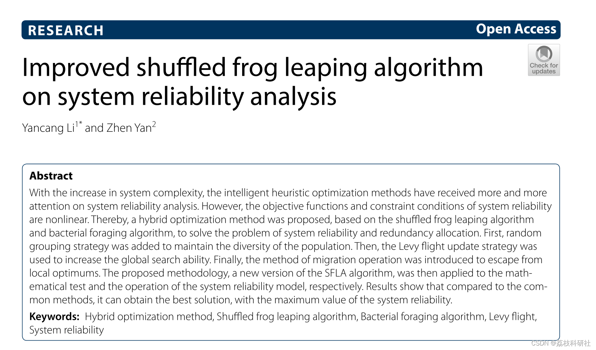
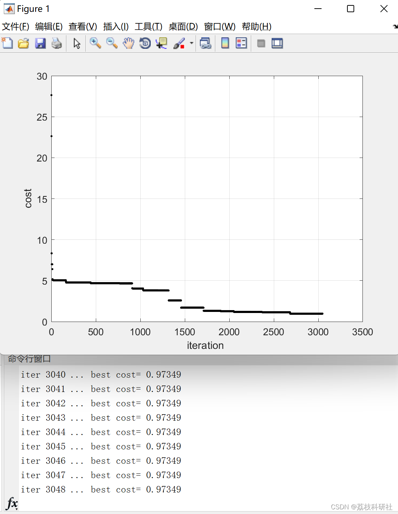
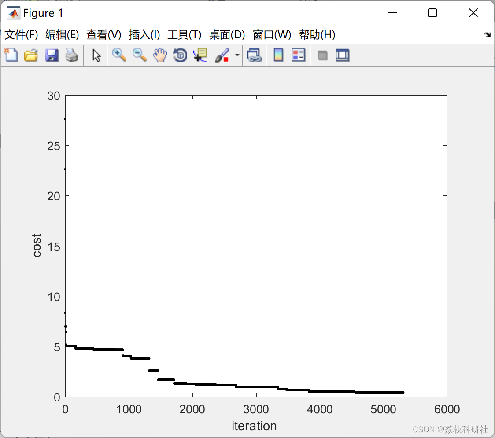
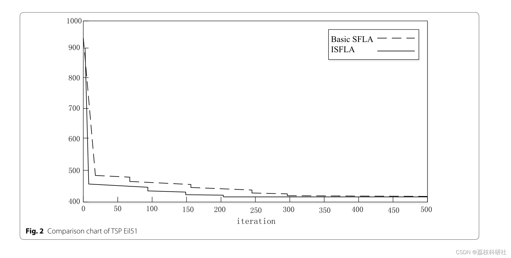

# Research on System Reliability Analysis Based on Improved Shuffle-and-Fly Algorithm (Matlab Code Implementation)

​  
Editor
As the complexity of systems increases, intelligent heuristic optimization methods are increasingly valued in system reliability analysis. However, the objective function and constraints for system reliability are nonlinear. Therefore, a hybrid optimization method based on shuffling water-flies algorithm and bacteria foraging algorithm is proposed to address the issues of system reliability and redundancy allocation. Firstly, a random grouping strategy is added to maintain population diversity. Subsequently, a Levy flight update strategy is utilized to enhance global search capabilities. Lastly, migration operations are introduced to escape local optima. This proposed method represents a new version of the SFLA algorithm, which is then applied to both mathematical testing of system reliability models and operational implementation. The results indicate that compared to conventional methods, this approach can obtain the optimal solution for maximum system reliability.
📚2 Running Results Editing
Editor
Article improvement effect:
Editor
Part of the code:
%% Majid Farzaneh  
%% Shuffled Frog Leaping Algorithm for optimization problems  
clc  
clear  
close all  
m=4; % Number of Memeplexes  
n=4;% Number of frogs in each memeplex  
F=m*n; % Number of frogs  
Nvar=10; % Number of Variables  
MaxIter=10000; % Maximum number of Iteration  
N=10; % Maximum Local iteration  
alpha=0.1;  
beta=1.5;  
v=1;  
u=1;  
%% initial population of frogs  
U=cell(1,F);  
for i=1:F  
U{i}=make_a_frog(Nvar);  
end  
%% optimization loop:  
for iter=1:MaxIter  
for i=1:F  
cost(i)=objfcn(U{i});  
end  
[vals,idxs]=sort(cost);  
best_cost=vals(1);  
Px=U{idxs(1)} ; % best Glogabl Frog  
disp(['iter ',num2str(iter),' ... best cost= ',num2str(best_cost)])  
plot(iter,best_cost,'k.')  
grid  
xlabel('iteration ');  
ylabel('cost')  
hold on  
pause(0.00001)  
for iii=1:numel(U) % Sort population  
U2{iii}=U{idxs(iii)};  
end  
U=U2;  
for i=1:m     % Step 5.2  
Y={};  
for j=(i-1)*n+1:i*n  
Y=[Y,U{j}];  
end  
Pb=Y{1};  
Pw=Y{end};  
for iN=1:N   % Step 5.3  
D=(Pb-Pw)*rand; % Step 5.4  
Pw2=Pw+D;  
if objfcn(Pw2)<objfcn(Pw) % Step 5.7  
Y{end}=Pw2;  
end  
end  
if isequal(Pw,Y{end}) % Step 5.8  
Y{end}=make_a_frog(Nvar);  
end  
for ny=1:numel(Y)  
Ycost(ny)=objfcn(Y{ny});  
end  
[Yval,Yidx]=sort(Ycost);  
for iii=1:numel(Y) % Sort population  
Y2{iii}=Y{Yidx(iii)};  
end  
Y=Y2;  
for jjj=n/2:n  
🌈3 Matlab Code and Article Explanation
🎉4 References
​  

## Images

<!-- PAYMENT_BLOCK -->

## Get this dataset

- Payment link (Stripe): [Buy now](https://buy.stripe.com/3cs8yP7sY87d0vu9AB)
- Payment QR code: 

<!-- /PAYMENT_BLOCK -->
